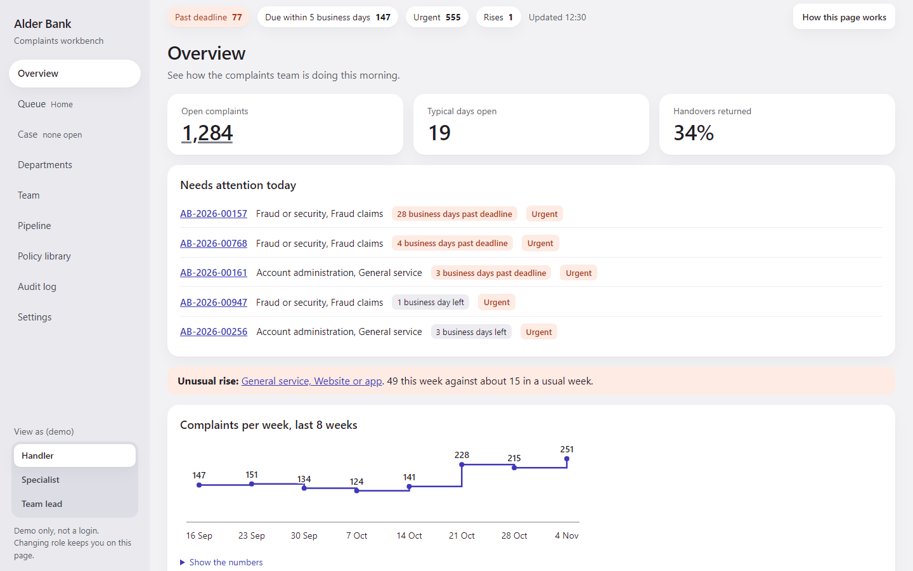
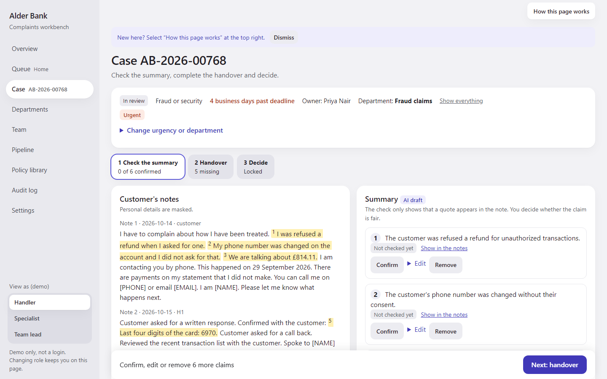
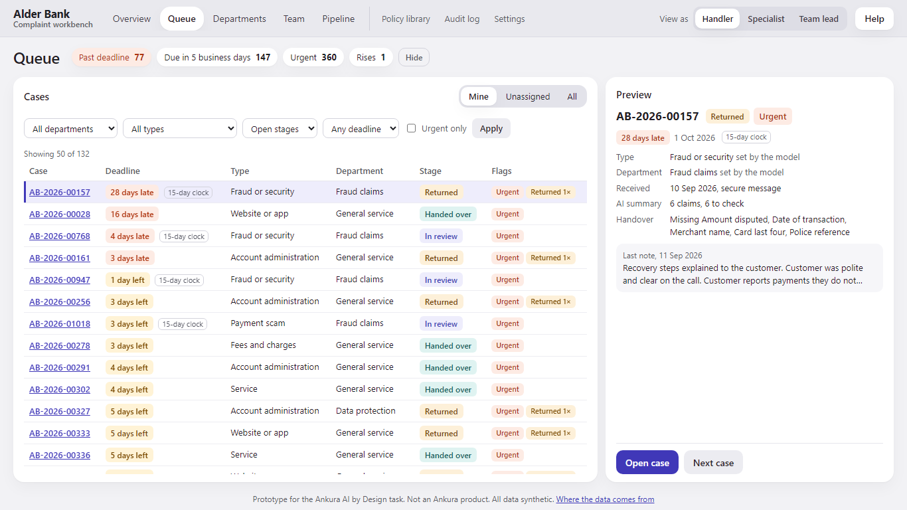
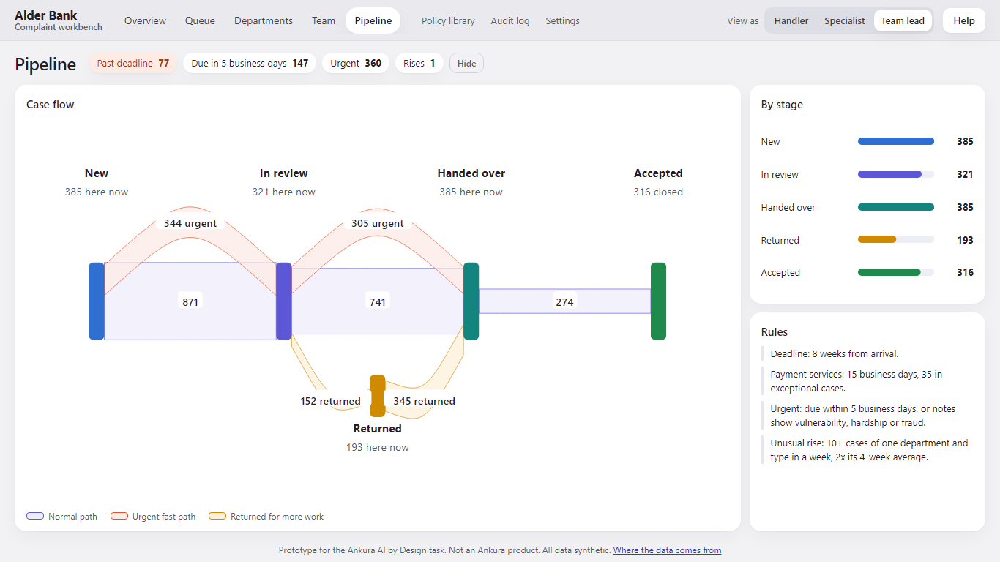
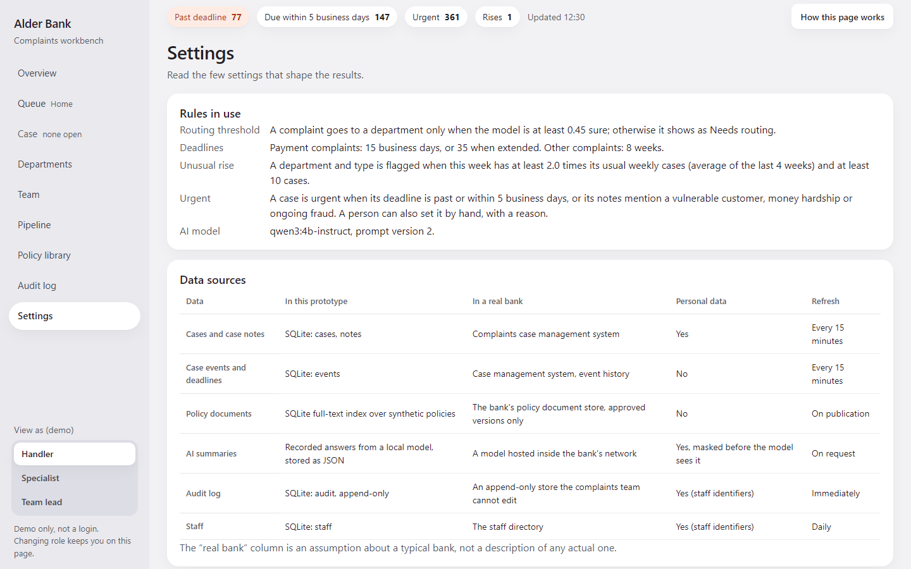

# Complaint Workbench

**A complaints desk where AI does the reading and a person makes every decision.**
Built for the Ankura AI by Design task, for a fictional bank (Alder Bank). All data is synthetic. Not an Ankura product.

UK firms received 1.85 million complaints in the first half of 2026, each on an 8-week clock (FCA). Handlers spend much of that time reading long notes and retyping them into handovers. The workbench routes each complaint, drafts a summary in which **every claim quotes the customer's own words**, checks those quotes word for word, and builds the handover. The handler confirms each claim; the specialist accepts or returns with a reason; every action is in a tamper-evident log.

**Try it in the browser: [akendall47.github.io/complaint-workbench-demo](https://akendall47.github.io/complaint-workbench-demo/)**, every page for each role. On case AB-2026-00768 every button that moves the case on works (recorded from the real app); for everything else, run it locally (below).



| Case: notes on the left, the AI summary on the right | Queue: preview and act without leaving the list |
|---|---|
|  |  |
| **Pipeline: how cases flow and where they come back** | **Settings: where every number in the demo comes from** |
|  |  |

## What makes it trustworthy

- **The model only drafts.** One stage in ten uses a language model (a small local Qwen model; drafts recorded in advance, no network calls). Routing and search are classic methods: TF-IDF with logistic regression, and BM25.
- **Quotes are checked, people confirm.** A claim whose quote is not found word for word is blocked (42 of 864). There is no bulk approve.
- **Personal data is masked before the model**; unmasking needs a reason and is logged.
- **Unsure routing goes to a person** (11.3% of cases), never a guess.
- **Every action is hash-chained**, so an edit after the fact is detected.
- **No speed league table.** Team views share work out; they do not rank people.

## Measured

| | |
|---|---|
| Tests | 527 automated (424 unit and property, 103 browser), all passing |
| One screen | 63 browser checks: 9 pages fit one window for all 3 roles |
| Speed | every page under 100 ms at 1,600 cases; the Overview takes 345 ms at 16,000 |
| Routing | 84.4% overall; 90.5% when sent on |
| Security | injection, tamper, cross-site and host checks pass; masking catches 21 of 22 test strings |

Every figure comes from one command (`uv run python tests/bench/bench.py --suites`); the full results and misses are in [docs/test-results.md](docs/test-results.md).

## Run it

```
uv sync
uv run workbench
```

The browser opens at http://127.0.0.1:8000. No key, no account, no network; the first start trains the two small models in a few seconds. Without uv: `pip install -e .` then `workbench`. To host it, `render.yaml` deploys it on Render's free plan.

**Two-minute tour.** "View as" (top right) switches role; it is a demo, not a login. As **Handler**, open a case from the Queue, confirm or fix each claim, fill the missing handover fields and approve. As **Specialist**, accept or return it on Departments. As **Team lead**, see the flow on Pipeline and every action on Audit log. Each page has a **Help** button.

## How it was built

Research first: an Obsidian vault of 113 linked notes ([vault/](vault/)) holds the complaint rules, AI risks, UX evidence and one note per design decision, so each choice can be traced to its source. Then a spec, a 13-task plan, and a build loop of AI builder agents writing tests first, each task checked by a separate read-only reviewer. [docs/loop-log.md](docs/loop-log.md) records what the reviews caught.

| | |
|---|---|
| [docs/deck.pdf](docs/deck.pdf) | five-page summary: value, risks and controls, how roles change, limits, AI used |
| [docs/test-results.md](docs/test-results.md) | every measured figure, with its limit |
| [docs/graph/](docs/graph/) | a map of the code (graphify): open `graph.html` |
| [docs/superpowers/specs/](docs/superpowers/specs/) | the design |

```
workbench/   rules (cases.py), masking, search, classifiers, stats, charts (fluid.py, flow.py)
  views/     one routes module per page area
  templates/, static/   pages, partials and one stylesheet per page area; no build step
config/      pipeline.yaml, the one configuration file
data/        workbench.db (1,600 synthetic cases), recorded drafts
tests/       unit, property, browser (e2e) and the bench
```

## Limits

- Synthetic data only: accuracy shows the method works, not how it would do on real complaints. Channel mix and time of day are our estimates.
- A quote check proves the words exist, not that the summary is fair; that is why a person confirms each claim.
- Policy search finds the right clause in the top five 13 times in 20.
- Masking is rule-based: a bare first name or an unusual number format can pass.
- The audit chain detects tampering but cannot prevent it; a real system would anchor it outside the database.
- The role switch is a demo, not a login. At 16,000 cases the Overview is slower than the 100 ms target.

Regenerate everything: `uv run python -m workbench.generate`, `uv run python -m workbench.classify`, and (with Ollama) `uv run python -m workbench.record`. Tests: `uv run pytest -q` and `uv run pytest tests/e2e -o addopts=""`.
